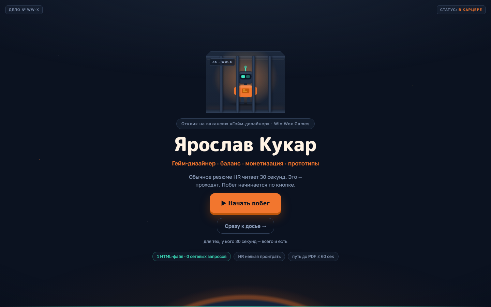

# Побег из досье — играбельное резюме для Win Wox Games

**Играть:** [kerarty.github.io/cv-winwox](https://kerarty.github.io/cv-winwox/) ·
нет времени играть — кнопка **«Сразу к досье»** прямо на титуле.

Играбельный отклик на вакансию **«Гейм-дизайнер»** в Win Wox Games (Prison Escape: Fun Run,
казуальные мобильные F2P). Резюме собрано как мини-казуалка: HR «совершает побег» по
станции-досье — шесть шлюзов-секций, карточки-монеты с фактами, живой тюнер лайвопс-события
и rewarded-пасхалка, которая открывает три гипотезы для их собственной игры.



## Зачем

Обычное резюме HR читает 30 секунд. Это резюме он проходит сам — и тем самым видит
главное требование вакансии в действии: *«понимание игр для неискушённой аудитории:
простота и баланс интереса/сложности»*. Форма отвечает содержанию — я делаю
playable-рекламу, поэтому и резюме собрано по её канонам:

- **один HTML-файл ~209 КБ**, ноль сетевых запросов в рантайме, работает офлайн и с `file://`;
- старт с одного клика, путь до PDF ≤ 60 секунд;
- **HR нельзя проиграть**: ни один элемент не блокирует прогресс, «фейл» отсутствует.

## Что внутри

- **Титул** — кандидат-робот в карцере за решёткой, «Начать побег» / «Сразу к досье»,
  каноны playable на чипах, планета-горизонт за кормой
- **Шлюз-интро** — створки разъезжаются, робот-кандидат выходит из камеры (единственный
  несделанный-на-действии момент анимации)
- **HUD** — дело № WW-X, прогресс шлюзов, таймер внимания HR (считаю чужие секунды),
  монеты-факты, звук (выкл по умолчанию), всегда доступные PDF и «Сразу к досье»
- **Шлюз 01 · Кто сбежал** — таймлайн, БГУИР, 17 играбельных резюме-игр
- **Шлюз 02 · Реактор** — Echoloop на Unity 6 + URP: 8 уровней, 26 автотестов
  проходимости, правило эха, скриншоты
- **Шлюз 03 · Мастерская баланса** — «Королевства Эридора» (15+ плейтестов), GDD под
  хендофф и **живой тюнер лайвопс-события**: слайдеры → кривые трёх когорт → вердикт
  по 5 проверкам (формулы считаются в браузере)
- **Шлюз 04 · Экономблок** — playble-ads SDK, Splash Kitty, MOB RUSH + **rewarded-пасхалка**:
  «посмотреть рекламу» → 3 секунды → секретный отсек с тремя гипотезами для
  Prison Escape: Fun Run
- **Шлюз 05 · Карцер** — честный блок: чего у меня пока нет (коммерческий live-ops)
- **Шлюз 06 · Форт Win Wox** — штамп «ГОДЕН К НАЙМУ», сводка (время/факты/шлюзы), CTA
- **Fallback** — noscript-версия, skip-режим «как документ», print-стили
- **Прямая ссылка на досье** — `?doc` или `#doc` открывают документ без игры (и не
  записывают skip в localStorage)

## Запуск

Игра — один файл, зависимостей нет:

```bash
# открыть index.html двойным кликом — уже работает
# или поднять локальный сервер:
python -m http.server 8000
```

Сборка из исходников (шрифты и скриншоты инлайнятся в один файл):

```bash
python build.py   # src/index.template.html + assets → index.html
```

## Стек

Vanilla JS + HTML5 + CSS3 — без фреймворков и сборщиков. Вся графика кодом (SVG/CSS),
звук — WebAudio-синтез, шрифты M PLUS Rounded 1c и Golos Text влиты woff2-base64.
Прогресс — в localStorage. RU-язык (вакансия русскоязычная).

Дизайн-документ: [GDD.md](GDD.md). Досье фактов: `design/candidate-content.md`.

## Контакт

Ярослав Кукар · +375 44 783 84 89 · kukar.yar@gmail.com · [github.com/Kerarty](https://github.com/Kerarty)
